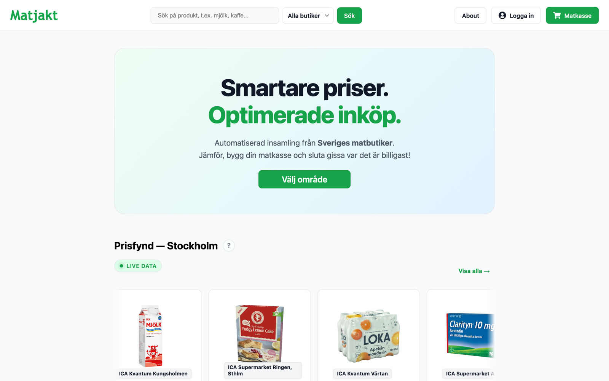
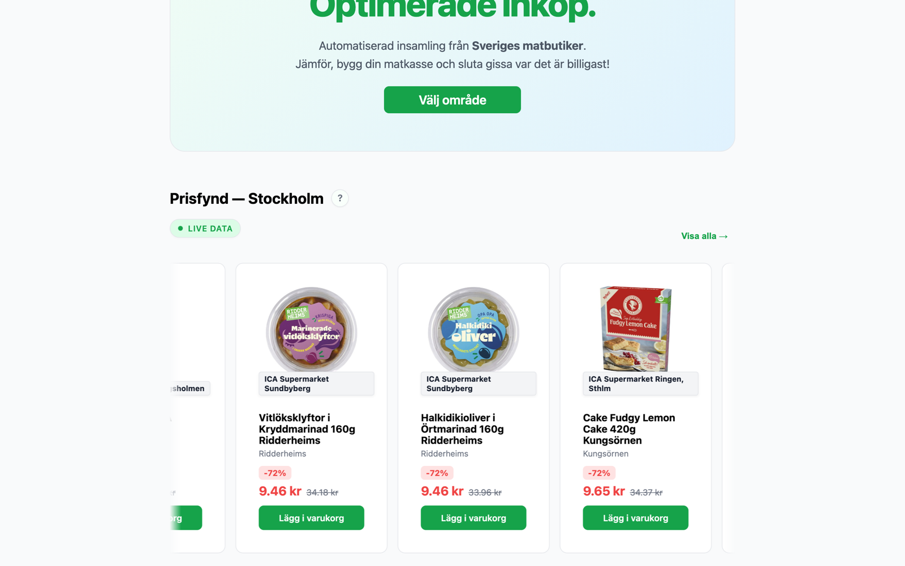
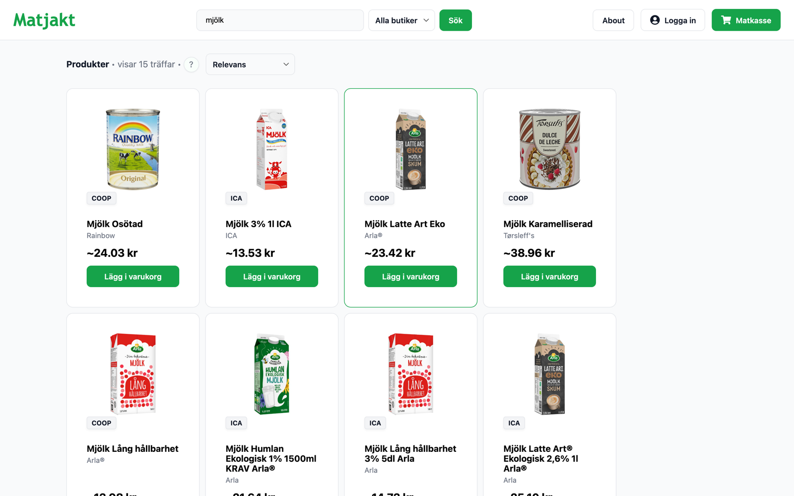
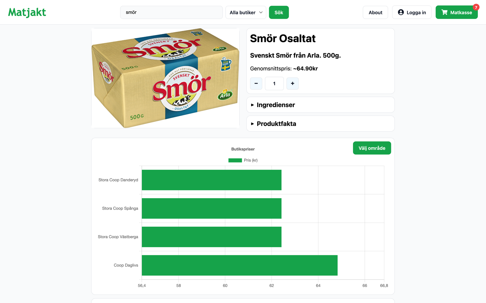
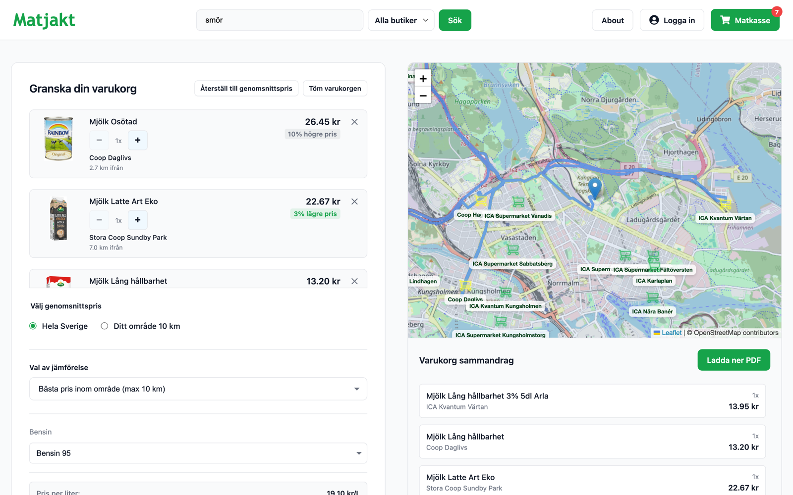
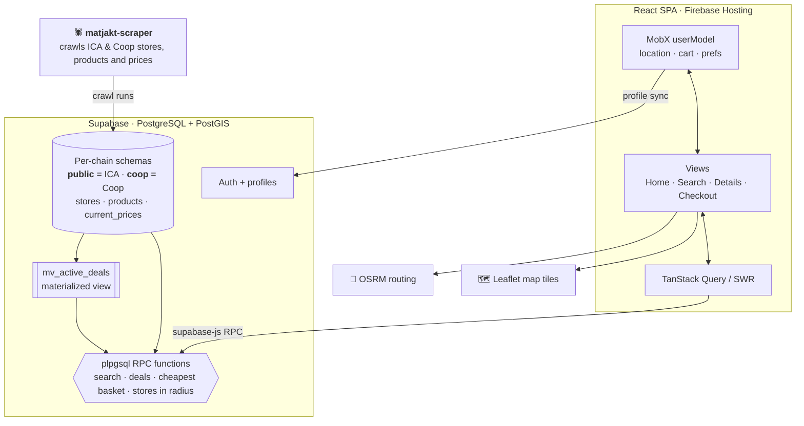
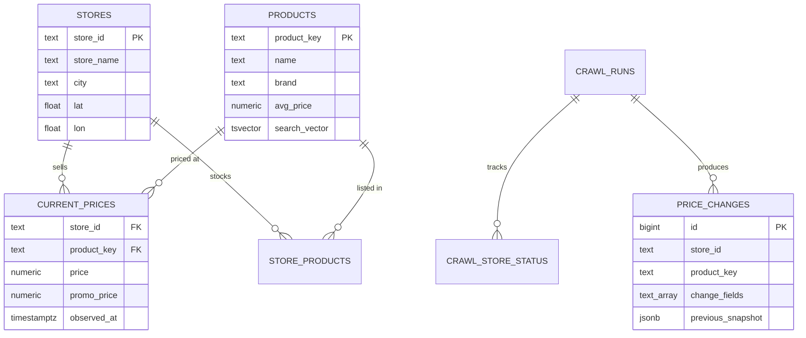
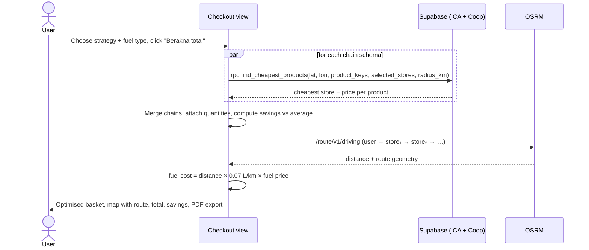

<div align="center">

# 🛒 Matjakt

**Data-driven grocery price comparison for Sweden**

Compare live prices from ICA and Coop stores near you, build a shopping list, and let Matjakt work out the cheapest way to buy it, including the driving route and fuel cost.


<sub>Bachelor's thesis project · KTH Royal Institute of Technology · 2026</sub>

<br/>



</div>

---

## Table of contents

- [Background](#background)
- [Features](#features)
- [Screenshots](#screenshots)
- [Architecture](#architecture)
- [How it works](#how-it-works)
  - [Data model](#data-model)
  - [Full-text product search](#full-text-product-search)
  - ["Prisfynd": finding the best local deals](#prisfynd-finding-the-best-local-deals)
  - [Basket optimisation and route planning](#basket-optimisation-and-route-planning)
- [Tech stack](#tech-stack)
- [Getting started](#getting-started)
- [Project structure](#project-structure)
- [Team](#team)

---

## Background

Food prices in Sweden have risen sharply in recent years. According to [Statistics Sweden (SCB)](https://www.scb.se/pressmeddelande/matpriserna-steg-nagot-2024/), grocery prices rose by **18.6% in 2022** and have stayed high since. Prices also differ a lot between chains and between individual stores, but comparing them by hand is slow, so most shoppers just guess.

**Matjakt** ("the food hunt") was built as our bachelor's thesis project at KTH to make grocery prices more transparent. Instead of comparing chain-wide list prices, it works with **per-store prices** gathered automatically from Swedish grocery chains (currently **ICA** and **Coop**) and combines them with geospatial queries. This lets it answer a practical question:

> *Given my shopping list and where I live, where should I buy each item, and how much will I actually save?*

## Features

| | Feature | Description |
|---|---|---|
| 📍 | **Location-aware** | Use browser geolocation or a Swedish postal code, then set a search radius (1–300 km). |
| 🔥 | **Prisfynd (best local deals)** | A live feed of the products priced furthest below their national average in stores near you. |
| 🔎 | **Fast full-text search** | Weighted Swedish and English full-text search with typo-tolerant trigram matching, run inside Postgres, with infinite scroll, chain filter and sorting. |
| 📊 | **Product details** | Ingredients, product facts and a bar chart comparing the product's price across nearby stores. |
| 🧺 | **Smart basket optimisation** | Three strategies: cheapest within your area, cheapest among stores you pick, or cheapest in all of Sweden. |
| 🗺️ | **Route and fuel cost** | Plots the stores on a map, computes a driving route through them (OSRM) and estimates fuel cost from current fuel prices. |
| 💸 | **Savings breakdown** | Compares your optimised basket against the national or local average price, per item and in total. |
| 👴 | **Senior discount** | Apply a percentage discount to the total. |
| 🧾 | **Export to PDF** | Print or download the optimised shopping list, grouped by store. |
| 👤 | **Accounts** | Email sign-up/login (Supabase Auth). Cart, location and preferences sync to your profile. |

## Screenshots

<table>
  <tr>
    <td width="50%">
      
      <p align="center"><b>Prisfynd:</b> the biggest discounts in stores near you, ranked by how far below the average price they are.</p>
    </td>
    <td width="50%">
      
      <p align="center"><b>Search:</b> relevance-ranked full-text search across both chains, limited to products sold nearby.</p>
    </td>
  </tr>
  <tr>
    <td width="50%">
      
      <p align="center"><b>Product page:</b> compare one product's price across nearby stores.</p>
    </td>
    <td width="50%">
      
      <p align="center"><b>Checkout:</b> the optimised basket, with the driving route and fuel cost on the map.</p>
    </td>
  </tr>
</table>

## Architecture



- **Data ingestion.** A separate scraper ([`matjakt-scraper`](https://github.com/adam-ostberg/matjakt-scraper)) crawls stores, products and per-store prices from ICA and Coop and writes them to Supabase. Each crawl is tracked as a *run* (`crawl_runs`, `crawl_store_status`), and price changes are logged to `price_changes`.
- **Database.** Each chain has its own Postgres schema (`public` for ICA, `coop` for Coop) with the same table layout. Heavy work such as geospatial filtering, ranking and aggregation runs **inside Postgres** as `plpgsql` functions called over RPC, so the client never downloads raw price tables.
- **Frontend.** A React 19 + TypeScript single-page app built with Vite and deployed to Firebase Hosting. Global user state (location, radius, cart, discounts) lives in an observable **MobX** model. Server data is fetched and cached with **TanStack Query** and **SWR** (infinite scroll).

## How it works

### Data model



### Full-text product search

Search runs in a single Postgres function ([`search_products.sql`](search_products.sql)) instead of a separate search engine like Elasticsearch:

1. **Location pre-filter.** PostGIS `ST_DWithin` on a GiST-indexed `geography` point finds stores within the user's radius. Only products sold in those stores are considered.
2. **Candidate matching.** A product matches if its `search_vector` matches a **Swedish** *or* **English** `websearch_to_tsquery`, *or* its name is trigram-similar (`pg_trgm`) to the query, which handles typos and partial words.
3. **Weighted ranking.** Each candidate gets a combined score:

   ```
   relevance = 3.0 · ts_rank_cd(swedish)
             + 2.0 · ts_rank_cd(english)
             + 8.0 if the name starts with the query  (3.0 if it only contains it)
             + 2.0 · trigram_similarity(name, query)
   ```

4. **Pagination.** Results are paged with `LIMIT/OFFSET` and loaded through `useSWRInfinite` plus an `IntersectionObserver` for infinite scroll. Input is debounced so the database isn't queried on every keystroke.

GIN indexes on `search_vector` and `lower(name) gin_trgm_ops` keep this fast across both chains' catalogues.

### "Prisfynd": finding the best local deals

The deals feed on the home page ranks products by how far their **current store price** is below their **average price across all stores**:

$$\text{relevance} = \frac{\overline{p}_{\text{product}} - p_{\text{store}}}{\overline{p}_{\text{product}}}$$

Computing this live for every store and product would be too slow, so we precompute it:

- A **materialized view** (`mv_active_deals`) holds every `(store, product)` pair currently priced below average, for both chains, with an index on `(store_id, relevance DESC)`. It is refreshed with `REFRESH MATERIALIZED VIEW CONCURRENTLY`, so reads are never blocked.
- At query time, [`get_best_local_deals`](get_best_local_deals.sql) only has to:
  1. find nearby stores (PostGIS),
  2. join them against the precomputed deals,
  3. keep the best deal per product (`DISTINCT ON`, tie-broken by distance),
  4. join the text-heavy `products` table for just the ~30 rows that are returned.

### Basket optimisation and route planning



Three optimisation strategies are available:

| Strategy | What it does |
|---|---|
| **Bästa pris inom område** | Cheapest store for each item within your chosen radius. Items not sold nearby are flagged "Utanför område". |
| **Bästa pris från utvalda butiker** | Pick specific stores on a list or the map. Each item is bought from the cheapest of those. |
| **Bästa pris (hela Sverige)** | The absolute cheapest price in the country, as a benchmark. |

Savings are shown against either the **national** average price or the average **within your area**, so you can see both "is this a good price?" and "is this a good price *here*?".

## Tech stack

| Layer | Technologies |
|---|---|
| **Frontend** | React 19, TypeScript, Vite, React Router |
| **State and data fetching** | MobX (`mobx-react-lite`), TanStack Query, SWR |
| **Maps and charts** | Leaflet / React-Leaflet, OSRM routing API, Chart.js (`react-chartjs-2`) |
| **Backend** | Supabase: PostgreSQL, PostGIS, `pg_trgm`, full-text search, plpgsql RPCs, materialized views, Auth |
| **Hosting** | Firebase Hosting (SPA rewrites, immutable asset caching) |
| **Tooling** | ESLint, TypeScript strict build (`tsc -b`) |

## Getting started

### Prerequisites

- Node.js 20+
- A Supabase project with the Matjakt schema and functions, populated by [`matjakt-scraper`](https://github.com/adam-ostberg/matjakt-scraper)

### Setup

```bash
git clone https://github.com/adam-ostberg/matjakt.git
cd matjakt
npm install
```

Create a `.env` file in the project root:

```env
VITE_SUPABASE_URL=https://<your-project>.supabase.co
VITE_SUPABASE_PUBLISHABLE_DEFAULT_KEY=<your-anon-key>
```

Run the dev server:

```bash
npm run dev
```

### Database functions

The SQL in [`search_products.sql`](search_products.sql) and [`get_best_local_deals.sql`](get_best_local_deals.sql) creates the indexes, the materialized view and the RPC functions the app depends on. Run them in the Supabase SQL editor. The `postgis` and `pg_trgm` extensions must be enabled.

### Build and deploy

```bash
npm run build       # type-check + production build to dist/
firebase deploy     # deploy dist/ to Firebase Hosting
```

## Project structure

```
src/
├── components/      # Reusable UI: OfferCard, LocationModal, AuthModal, dropdowns, …
├── context/         # React contexts: authentication, toast notifications
├── data/            # Swedish postal code → coordinate lookup
├── hooks/           # useProductSearch, useBestLocalDeals, useProfileSync, useDebounce
├── models/          # MobX userModel (location, cart, prefs) + postal code model
├── presenters/      # Presenter layer (Model–View–Presenter)
├── types/           # Database row types
├── utils/           # Supabase clients (ICA + Coop schemas), distance formulas
└── views/           # Pages: Home, Search, Details, Checkout, Profile, About
search_products.sql        # Full-text search function + indexes
get_best_local_deals.sql   # Deals materialized view + function + indexes
```

## Team

Matjakt was built by:

- **Adam Östberg**
- **Gustav Lundborg**
- **Rasmus Nordahl**
- **Christopher Massi**

<sub>Prices are collected automatically and may differ from what's on the shelf. Matjakt is not affiliated with ICA or Coop.</sub>
